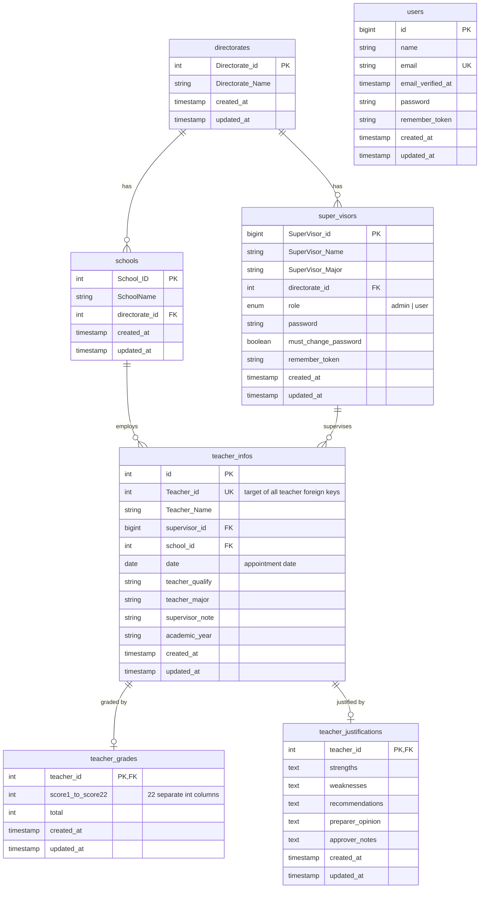

# Reports database ERD

Schema as it stands after all migrations in `Reports/database/migrations` have run.

## Notes

- `teacher_infos` has two identifiers: the auto-increment primary key `id`, and the unique `Teacher_id`, which every foreign key and the Eloquent model use.
- `teacher_grades` and `teacher_justifications` are one-to-one with a teacher; their primary key `teacher_id` is also the foreign key to `teacher_infos.Teacher_id`.
- `score1_to_score22` stands for 22 separate integer columns, `score1` through `score22`.
- `users` is the default Laravel table and is not related to the other tables. Login runs through `super_visors`.
- Laravel framework tables (`sessions`, `cache`, `cache_locks`, `jobs`, `job_batches`, `failed_jobs`, `password_reset_tokens`) are omitted.
