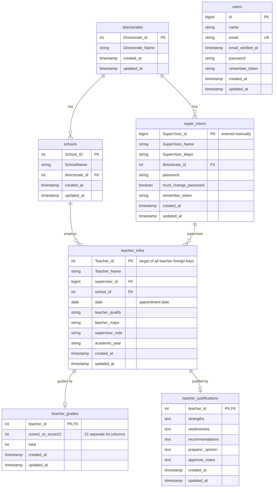

# Reports database ERD

Schema as it stands after all migrations in `Reports/database/migrations` have run.

## Notes

- `teacher_infos` is identified by `Teacher_id`, its primary key. The old auto-increment `id` column was dropped in November 2026.
- `teacher_grades` and `teacher_justifications` are one-to-one with a teacher; their primary key `teacher_id` is also the foreign key to `teacher_infos.Teacher_id`.
- `score1_to_score22` stands for 22 separate integer columns, `score1` through `score22`.
- There are two kinds of login. Admins log in through `users` (the `admin` guard); supervisors log in through `super_visors` (the `web` guard). Admin rights come only from `users`; the old `super_visors.role` column was dropped in November 2026.
- `users` has no foreign keys to the other tables.
- Laravel framework tables (`sessions`, `cache`, `cache_locks`, `jobs`, `job_batches`, `failed_jobs`, `password_reset_tokens`) are omitted.